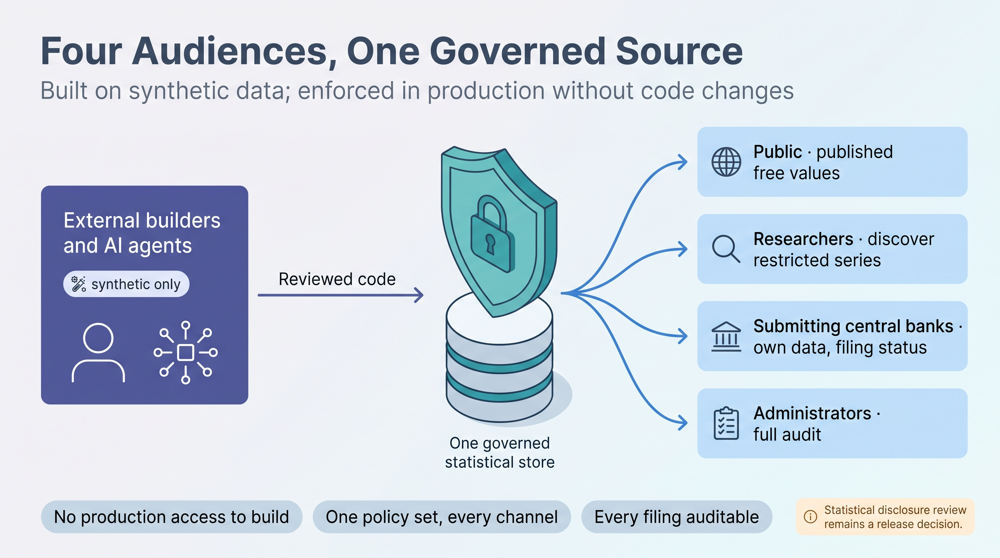
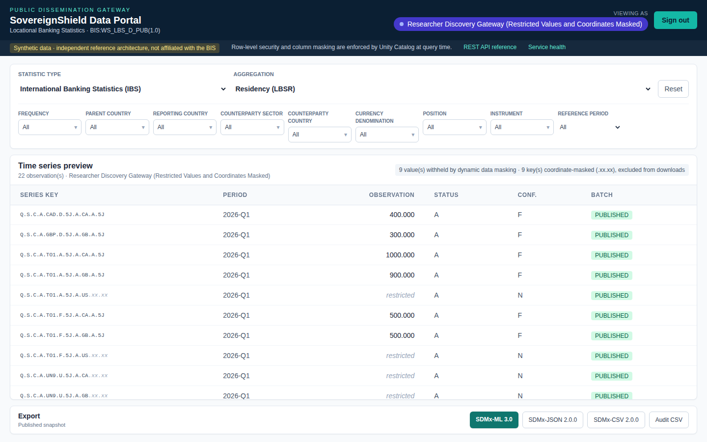
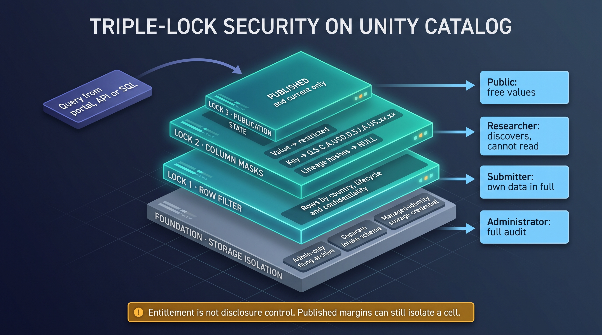

# LinkedIn First Post: Copy-Ready Text and Preview

The first publication in the [LinkedIn publication plan](LINKEDIN_POST.md) is the anchor
article. LinkedIn publishes an article and, in the same step, shares it to your feed with a
short introduction. This page holds both, with the images embedded where they go, so the
whole post can be previewed here before anything is pasted.
Clear every [gate before posting](LINKEDIN_POST.md#gates-before-posting) first.

## What Goes Where, Step by Step

**Day 1: publish the article (Parts A and B, together)**

1. On the LinkedIn home page, select **Write article**. If you manage a page, choose to
   publish as yourself.
2. **Cover image.** Select the cover image area at the top of the editor and upload
   `docs/figures/ai/four_audiences.jpg`. It is shown under
   [Cover image](#cover-image) below.
3. **Headline.** Copy the text in [Headline](#headline) into the **Title** field.
4. **Body.** Open this file in GitHub's rendered view, select the article body from
   "My work has long sat..." to the hashtags, and paste it into the editor. Headings, bold
   text and lists carry over; check them after pasting.
5. **Inline images.** Each image below marks its position. Place the cursor there, use
   the editor's image button to upload the file, and type the caption shown under it into
   the image's caption field. Then delete any image placeholder text that was pasted.
6. **Review.** Use **Preview** on desktop, then check the published article on a phone.
7. **Share text (Part B).** Select **Next**. LinkedIn opens a share box that asks you to
   tell your network what the article is about. Paste the [Part B](#part-b-share-text-for-the-article)
   text there and select **Publish**. The article and this introduction appear together in
   your feed.

**Day 3 or 4: the Executive Brief (Part C)**

Part B is **not** the later post: it is published together with the article on Day 1.
The second post, two or three days later, is the Executive Brief as a document post.
Select **Start a post**, then the document option (**+** > **Add a document** on
desktop), upload the reviewed brief PDF, title it "Sovereign Shield: Executive Brief",
and paste [Part C](#part-c-executive-brief-post-two-or-three-days-later) as the post text.
A posted document cannot be replaced: before uploading, check that the brief's figures
match the [evidence register](RELEASE_EVIDENCE.md#reference-evaluation-metrics). The
brief still states the earlier 35-minute teardown and must be updated and re-proofed
before this post.

**After posting**

Add the article and the brief post to **Featured** on your profile, and answer comments
with evidence, as described in [feature, engage and measure](LINKEDIN_POST.md#5-feature-engage-and-measure).

**Figures quoted.** The bring-up time, the 32-minute teardown, Azure charges and the
offline test count are recorded in the [evidence register](RELEASE_EVIDENCE.md). The
399 tests are the offline suite run on 12 October 2026. Recheck them against the frozen
commit before posting.

---

## Part A: Article

### Cover image



*Upload as the cover image. Caption (if asked): "AI-generated illustration".*

### Headline

```text
Build without seeing: how contractors and AI agents can engineer a statistical data platform without touching confidential data
```

### Body

My work has long sat where data governance meets international statistics: group-based
row-level security for regulatory returns on a commercial cloud platform, and a banking
statistics pipeline modernized to produce SDMX 3.0. Through extensive experience working
with data, and many discussions with data experts, three topics have piqued my interest
the most.

- **Executives** want masking they can trust: not "the developer promises not to look", but
  controls no developer can talk their way around.
- **Data holders** want to work with researchers without handing over the data.
- **Reporting analysts** who file several submissions want a simple answer: which copy does
  the international organization actually hold?

The reporting institution may be a central bank or a national statistical office. In the
sample used here, the BIS Locational Banking Statistics, it is a central bank.
International organizations often build their SDMX stacks on open source, while many
central banks and national statistical offices run on a commercial cloud. I wanted to see
what the same controls look like on Azure Databricks, so I built Sovereign Shield: an
independent reference architecture on synthetic data only, with the code, evidence and
limits published so others can study, reuse and challenge it.

#### The contractor dilemma

Statutory confidentiality says contributors' data is used for statistics and released only
when no one can be identified. Yet the engineering that enforces it (Unity Catalog
policies, Delta Lake history, SDMX serialization, Terraform) is increasingly delivered by
integrators, contractors and AI coding agents. Giving builders production access in order
to build the controls that protect production is a contradiction.

#### The pattern: build without seeing

1. **Contract, not data.** The data owner approves metadata only: the BIS LBS 1.0
   structure, codelists, 21 validation rules and a persona matrix. Builders generate
   synthetic SDMX filings that exercise every branch.
2. **Policies travel with the table.** Unity Catalog row filters and column masks decide
   per caller, per row and per cell. The same SQL runs in staging and production.
3. **Prove it offline.** 399 credential-free tests run without cloud access, and they fail
   if a control is removed.
4. **Hand over and revoke.** The institution imports a reviewed release, owns every
   identity and offboards the builders.

Four personas read one governed store:

- the **public** sees free values;
- **submitting analysts** see their own filings in every state, so they can reconcile what
  they sent with what the receiver holds;
- **administrators** see the full audit trail;
- and **researchers** get something new.



*Inline image 1. Caption: "Discovery Gateway: restricted observations are visible, their
values and counterparties are not. Synthetic data."*

#### The idea I most want feedback on: a Discovery Gateway

A researcher should be able to discover that confidential data exists, so they can
approach the submitting central bank or national statistical office, without learning the
value or even exactly what it describes. For restricted cells the platform withholds the
value and masks the counterparty:

**Q.S.C.A.USD.D.5J.A.US.A.5J** becomes **Q.S.C.A.USD.D.5J.A.US.xx.xx**

Masked rows never appear in a download, so a researcher's export is identical to the
public one.



*Inline image 2. Caption: "AI-generated illustration".*

#### Two lessons that surprised me

**Masking a value is not enough if you leave its fingerprints.** A row hash built from the
full key can be brute-forced back to hidden coordinates in a few thousand guesses, and a
payload hash confirms a guessed value. Both are now masked by the same rule.

**Masks must resolve before filters**, or a researcher can filter by counterparty and watch
which restricted row appears. Unity Catalog applies masks first, and the tests hold the
local mirror to the same rule.

#### What it does not solve

Access control is not disclosure control. In the synthetic data, a published total of
1,000 minus public components of 400 and 500 still reveals a restricted cell of 100,
masked coordinates or not. That example has a single restricted cell. When several cells
in the same table are masked, as is typical for most statistics, working back to any one
value becomes much harder, though not necessarily impossible. What is needed beyond the
implemented controls, such as complementary suppression decided by the data authority, is
therefore a case-by-case decision based on an understanding of the statistic the
architecture is applied to. Researchers who genuinely need restricted cells belong in a
secure enclave: approved projects, no raw export, reviewed outputs. That part is a
concept, not code.

#### Beyond statistics

The same question now faces AI assistants grounded in enterprise knowledge: retrieval
should return only the evidence the person asking is entitled to see. Binding that rule to
the data, letting signed-in channels query with the caller's own identity and giving
anonymous traffic a least-privileged public identity, never one shared privileged account,
keeps the decision in one governed place. Sovereign Shield does not include an assistant,
but its gateway faces the same identity question.

#### Evidence

With prerequisites already in place, a complete Azure deployment came up in about 42
minutes, and the latest teardown took about 32, for US$10 or less in Azure charges per
cycle. Those are synthetic evaluation numbers, not production estimates. The code, white
paper and an open reconstruction challenge are here: https://github.com/botlhale/sovereign-shield

*Independent, educational work on synthetic data and public standards, written in a
personal capacity. It is not the work of the Bank of Canada or any other institution, and
the views are my own.*

**Where would you draw the line between discovery and disclosure?** If you have solved this
differently, in statistics or elsewhere, I would like to compare notes.

#SDMX #DataGovernance #Databricks #StatisticalDisclosureControl #DataArchitecture

---

## Part B: Share Text for the Article

Paste into the share box after selecting **Next** in the article editor (Day 1, step 7).
LinkedIn shows the article's cover image and headline under this text as a link card.

```text
Can a contractor, or an AI coding agent, build the controls that protect confidential statistics without ever seeing the data?

I tested that question on Azure Databricks with Sovereign Shield, an independent reference architecture built on synthetic data only.

The pattern in four steps:
1. Contract, not data: builders get the SDMX structure, codelists, validation rules and a persona matrix, never the filings.
2. Policies travel with the table: Unity Catalog row filters and column masks decide per caller, per row and per cell.
3. Prove it offline: 399 credential-free tests run without cloud access, and they fail if a control is removed.
4. Hand over and revoke: the institution owns every identity and offboards the builders.

The part I most want challenged is a Discovery Gateway: researchers can learn that a confidential cell exists, and approach the reporting central bank or national statistical office, without learning its value or exactly what it describes.

The article also covers what this does not solve. Access control is not disclosure control: a published total can still give a single restricted cell away, so what more is needed depends on the statistic.

Where would you draw the line between discovery and disclosure?

Code, white paper and an open reconstruction challenge: https://github.com/botlhale/sovereign-shield

Independent, educational work in a personal capacity; views are my own and no institutional or vendor endorsement is implied.

#SDMX #DataGovernance #Databricks #StatisticalDisclosureControl
```

## Part C: Executive Brief Post, Two or Three Days Later

Upload the reviewed brief PDF as a document titled "Sovereign Shield: Executive Brief" and
paste this as the post text. The same text is in the
[publication plan](LINKEDIN_POST.md#2-executive-brief-post).

```text
Can an external team build the controls for confidential statistics without ever seeing the data?

The eight-page Executive Brief behind this week's article summarizes the pattern for architecture boards: four personas over one governed store, how an analyst reconciles the latest filing with the accepted publication, and what still needs a disclosure decision. It closes with the questions worth asking before any pilot.

Article, white paper and code: https://github.com/botlhale/sovereign-shield
Independent, educational work on synthetic data; views are my own and no institutional or vendor endorsement is implied.

#SDMX #DataArchitecture #DataGovernance
```
